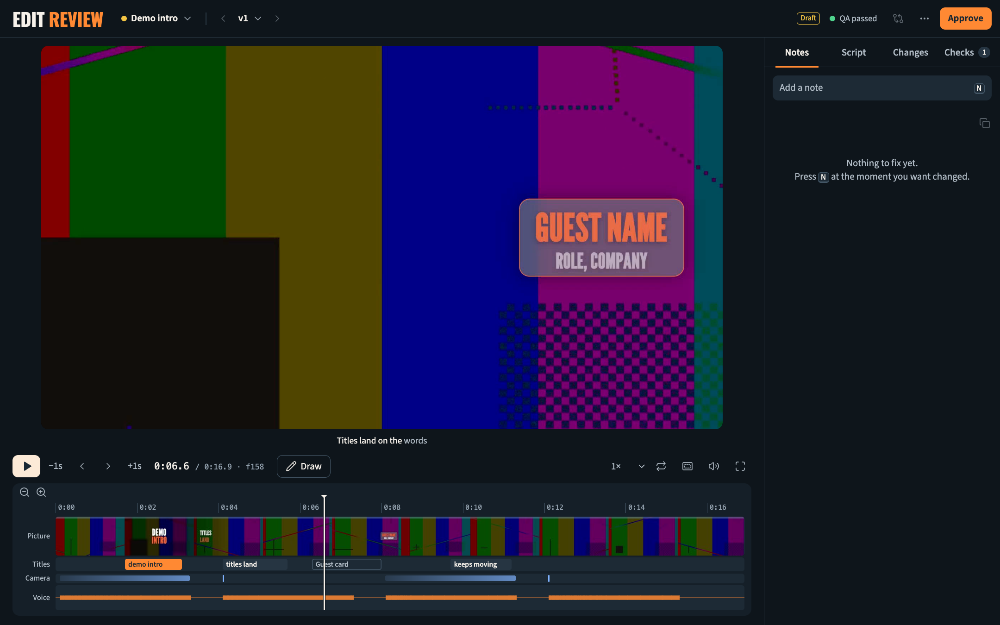

# Podcast Intro Studio

Cut a podcast episode intro from a raw host recording. The edit is a JSON file, the picture is built with [HyperFrames](https://hyperframes.heygen.com) (HTML rendered to video), and every render lands in a local review app where you scrub, leave timestamped notes and compare versions. A [Claude Code](https://claude.com/claude-code) skill is included, so you can hand Claude a recording and say "make the intro".



## What it does

- **Finds the take.** Transcribes the recording, lists every complete take, trims to the first and last real word, cuts repeated false starts and ducks breaths.
- **Frames the speaker.** Measures camera roll and face position, levels and centre-crops, and keeps the top of the head in frame on every zoom.
- **Builds the edit from a config.** Opener card over a punch-in, titles that land on the spoken word, push-ins and punch-in cuts, B-roll cutaways with wipes, a guest card, picture-in-picture, titles that sit behind the speaker.
- **Checks before it renders.** A linter turns the editing rules into checks (a title that doesn't match the words, a 3-frame flash of the host, 5 seconds with nothing happening) and stops the build on errors.
- **Gates every render.** Black or frozen frames, loudness and true peak, dead air, clipped first and last words, plus a contact sheet.
- **Review app.** Versions, a multi-track timeline, frame stepping, notes with drawings on the frame, side-by-side compare, a script that follows playback, and an "Apply notes" button that hands your open notes to Claude Code and renders the next version.

## Requirements

- macOS or Linux, Node 20+, `ffmpeg` with x264 and VP9, Python 3
- Internet on the first run (HyperFrames is fetched with `npx`, pinned to `0.8.209`, and downloads the title font once)
- Optional: `pip install -r tools/requirements.txt` in a `.venv` for the camera level check; the `claude` CLI for "Apply notes"

```bash
npm run doctor
```

## Try it without footage

```bash
npm run demo
```

```bash
npm run review
```

The demo makes a stand-in recording (a test pattern with a tone for the voice), builds an intro on it and renders it. Open http://localhost:3280 to see it in the review app.

## Cut a real intro

1. **Set up the show.** Copy `brand.example.json` to `brand.json` and fill in the show name, the words every intro ends on, your colours and, if you have one, a title font and a logo:

   ```json
   {
     "show": "Your Show",
     "ending": "welcome to the show",
     "colors": { "ink": "#15202B", "accent": "#FF6B35", "cream": "#F6EFE6", "paper": "#F7F5F2" },
     "font": { "family": "My Display", "files": { "700": "MyDisplay-Bold.otf" } },
     "logo": "logo.png"
   }
   ```

   Font files go in `intro-template/assets/fonts/`, the logo in `intro-template/assets/brand/`. Both folders are git-ignored, so licensed files stay on your machine. With no font set, titles use League Gothic.

2. **Make the host's opener card** (once per host):

   ```bash
   node tools/make-opener.mjs "Alex Rivera" --role "Host, Your Show"
   ```

3. **First pass from the recording:**

   ```bash
   node tools/new-episode.mjs --host /path/to/recording.mp4 --title "Episode Title" --host-name alex-rivera --guest "Guest Name|Role, Company"
   ```

   This writes `episodes/<date>-<host>-<title>.json` with the take, trims, breaths, framing and proposed camera moves.

4. **Write the edit** in that file: titles (`punches`), B-roll (`cutaways`), the guest card. All times are seconds in the source recording, read straight off the transcript.

5. **Lint, build, render:**

   ```bash
   node build.mjs episodes/<slug>.json --lint
   ```

   ```bash
   node build.mjs episodes/<slug>.json --draft --render
   ```

   Drop `--draft` for the delivery render. Each render is a new version in the review app.

## The episode config

| Field | What it does |
| --- | --- |
| `sources` | names for your files: `{ "host": "/path/to/recording.mp4", "screen": "…" }` |
| `host.in`, `host.out`, `host.tail` | the take, and how long to hold the picture, silent, after the last word |
| `host.remove` | `[[from, to]]` windows cut out of the take (false starts) |
| `host.breaths` | windows ducked 12 dB |
| `host.frame` | `center` (the face), `headTop`, `rotate` (levels a tilted camera), `scale` |
| `host.zoom` | the punch-in under the opener card |
| `host.moves` | `{at, scale}` is a punch-in cut; `{at, scale, to, dur}` a slow push |
| `opener` | the alpha layer, how long it holds, the frosted glass behind its card |
| `punches` | titles: `"two / *lines*"`, with `*accent*` words; `style` is side (default), `center`, `top` or `behind` |
| `cutaways` | B-roll over the voice: `src`, `in`, `out`, `at`, plus `speed`, `zoom`, `wipe`, `kind`, `speaker` |
| `insets` | picture-in-picture: the host in a corner over B-roll, or a clip in a phone frame |
| `guestCard`, `guest` | lower-third with the guest's name and role |
| `hooks` | cold-open soundbites from another recording, played before the host |
| `project`, `cut`, `cutLabel` | group alternate openings of one intro in the review app |

`episodes/_template.json` has every field with its default, and `tools/lint.mjs` explains anything it flags.

## Use it with Claude Code

```bash
ln -s "$PWD/skill" ~/.claude/skills/podcast-intro
```

Then, in Claude Code: "make the intro for this episode" with the path to your recording. The skill (`skill/SKILL.md`) carries the editing rules: pacing, title style, when to cut, how B-roll is treated. Notes you mark as standing rules in the review app are written to `review/learned-preferences.md`, so the next intro starts from your taste.

"Apply notes" in the review app runs `claude -p` on your machine with file edits and `node`, `npx`, `ffmpeg` and `python3` allowed inside this folder. It only starts when you click it.

## Layout

```
brand.json            your show (git-ignored)
build.mjs             config → HyperFrames project → render
episodes/             one JSON edit per intro (git-ignored, except the template)
tools/                new-episode, make-opener, lint, qa, doctor, demo and the measuring scripts
review/               the review app (server.mjs, app.html) and the Apply-notes prompt
skill/                the Claude Code skill
intro-template/       fonts, logo and opener layers for the build
broll/                your motion graphics; screens/ makes 3D cards from screen recordings
test/                 npm test
```

Footage, transcripts, renders, notes and brand files are all git-ignored. The review server listens on 127.0.0.1 only and refuses requests from other sites.

## Tests

```bash
npm test
```

## License

MIT. HyperFrames is a separate project with its own license.
